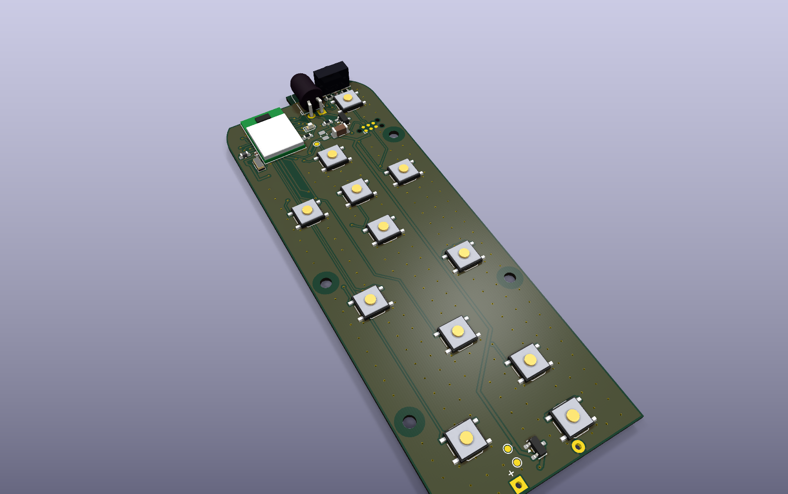
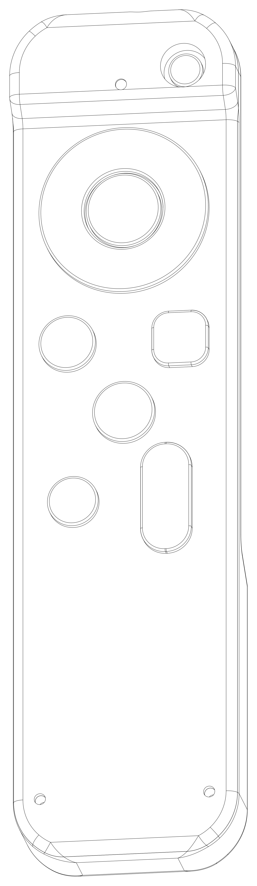

# Antuna Remote

A remote for Apple TV with buttons that click, over infrared and
Bluetooth, built for the Antuna IPTV app. Up and down change channel while live TV plays. PCB in KiCad, enclosure
as code, firmware on an nRF54L15.

Start with `CLAUDE.md` for how the repo works, and
`openspec/changes/` for what is being built now.

## What it looks like now

| Board, rev A | Grip mock-up |
| --- | --- |
|  |  |

`docs/renders/` has every view: the schematic, both sides of the board in
3D and as copper, and the mock-up's parts. They are redrawn in the same
commit as any change to what they show.

## Roadmap

1. `prove-the-apple-tv-link`: a dev board sends Apple's IR codes and
   pairs over Bluetooth, drives the Home screen and changes channel in
   Antuna. Everything below waits for it.
2. Key layout and feel: the buttons, their spacing and labels, drawn and
   tried as a printed mock-up.
3. Power: battery type, life at a stated use, charging if any.
4. PCB rev A: module, IR LED, key matrix, power, programming header,
   assembled by a PCB assembly service so only the battery holder and
   buttons might need soldering at home.
5. Enclosure rev A: printed shell around rev A, fit checks as tests.
6. Firmware for rev A: key scan, sleep, pairing button, battery report.

## Licence

Hardware under CERN-OHL-P-2.0, software under MIT, documents under
CC-BY-4.0. `LICENSE.md` says which files are which.
